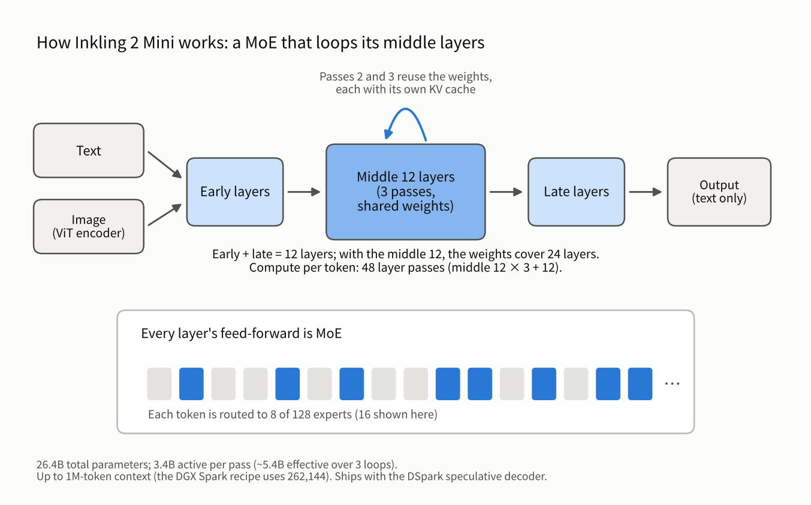
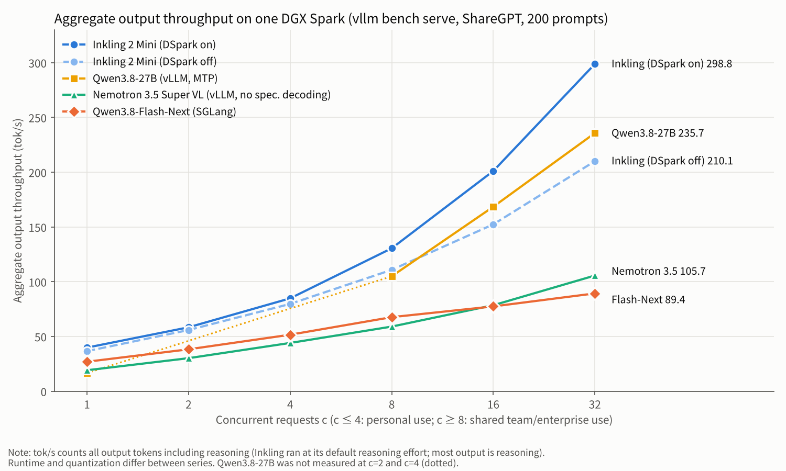
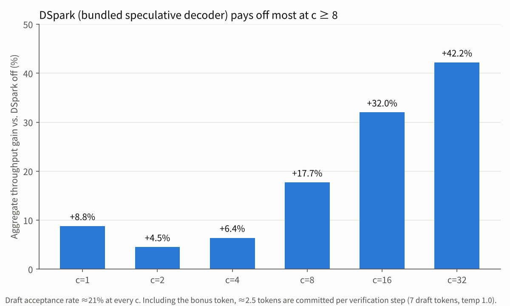
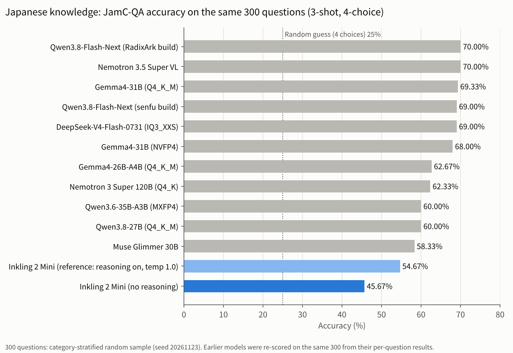

# Inkling 2 Mini on a single NVIDIA DGX Spark: first benchmarks with vLLM

Thinking Machines Lab released **Inkling 2 Mini** on November 20, 2026, with Apache 2.0 weights on Hugging Face and "1x NVIDIA DGX Spark" listed as tested hardware. We ran it on one DGX Spark three days after release, using the official checkpoint as-is, and measured two things: serving throughput and Japanese knowledge (a 300-question subset of JamC-QA). This is a quick first look, not a full evaluation. Coding, agentic and multimodal performance were not measured.

## TL;DR

- **Fast on one DGX Spark.** Aggregate output throughput is 36.6–39.9 tok/s at 1 concurrent request and 210–299 tok/s at 32, the latter with the bundled DSpark speculative decoder. At c=1 it is ahead of every earlier model we compare against below, measured on the same machine. At c=32 it leads only with DSpark on: without DSpark, Qwen3.8-27B with vLLM and MTP (235.7 tok/s) is faster.
- **DSpark pays off mainly at c ≥ 8.** Its throughput gain is small at 1–4 concurrent requests (+4.5% to +8.8%) and grows to +42% at 32. Time to first token (TTFT) is longer with DSpark at every concurrency level.
- **GB10 gotcha: kernels recompile for every new prompt length.** On SM121 the MoE expert kernels are Triton kernels whose launch plan is a compile-time constant derived from the token count, so each new prompt length adds about 2.5 s of TTFT until it has been compiled. An open vLLM PR fixes this; until it lands, warm up and persist the Triton cache.
- **Weak on Japanese factual knowledge.** 137 of 300 questions (45.67%) without reasoning, the lowest of the 12 configurations we compared on the same questions. This is consistent with the model card's notes on weaker factual recall and on quality outside English.

## About the model



- **Looped layers.** The checkpoint has 24 layers. The middle 12 are run three times per token with shared weights, so each token passes through 48 layers. Each pass keeps its own KV cache.
- **Sparse MoE.** Each layer's feed-forward block routes every token to 8 of 128 experts.
- **Size.** 26.4B total parameters, 3.4B active per pass (about 5.4B effective over the three loops). The checkpoint is about 20 GB in mixed NVFP4 / MXFP8, which Blackwell GPUs, including the GB10 in DGX Spark, run natively.
- **I/O.** Text and image in, text out, up to 1M tokens of context.
- **DSpark.** A small speculative-decoding drafter ships in the same checkpoint.

Thinking Machines Lab was founded in 2025 by former OpenAI CTO Mira Murati. Inkling 2 Mini is the local-scale member of its second model generation, after Inkling 2 Small (594B) on November 5.

## Setup

| Item | Value |
|---|---|
| Hardware | 1 × NVIDIA DGX Spark (GB10, 128 GB unified memory) |
| OS / driver | DGX OS 7.6.0, kernel 7.0.0-1019-nvidia, driver 580.178.04 (open) |
| Runtime | `vllm/vllm-openai:nightly-647a76866b4559a74e27d1c6b55fbffe85c07ce4` (built 2026-11-22, vLLM 0.34.0rc1.dev1133) |
| Weights | `thinkingmachines/Inkling-2-Mini`, revision `b85c3cf`, unmodified |
| Benchmark client | `vllm bench serve` (vLLM 0.19.1), ShareGPT_V3_unfiltered_cleaned_split, 200 prompts, `openai-chat` backend |

Server flags (inside the container):

```bash
vllm serve thinkingmachines/Inkling-2-Mini \
  --max-model-len 262144 \
  --gpu-memory-utilization 0.75 \
  --max-num-seqs 64 \
  --kv-cache-dtype auto \
  --no-enable-prefix-caching \
  --reasoning-parser inkling
# DSpark on: add
#   --speculative-config '{"method":"dspark","num_speculative_tokens":7,"draft_sample_method":"probabilistic"}'
```

- **Why a nightly image.** As of November 25, 2026, the latest vLLM release (v0.34.0) does not include Inkling 2 Mini, and the official recipe requires the unreleased 0.35.0. We picked the newest nightly that includes both the model support (vllm#69028) and the SM12x routing improvement (vllm#69021). The dedicated `vllm/vllm-openai:inkling-2-mini` image predates the latter.
- **Context length 262,144** is the value in the official recipe for DGX Spark. The KV cache is BF16.
- **`--gpu-memory-utilization 0.75`** instead of the recipe's 0.9, because GPU and host share memory on DGX Spark.
- **Prefix caching off**, because the same 200 prompts are reused at every concurrency level and cache hits would understate TTFT. We confirmed zero hits in `/metrics`.
- **Sampling.** Requests carried no sampling parameters, so the server default from `generation_config` applied (temperature 1.0, default reasoning effort).
- Other services on the machine were stopped during the runs. No thermal throttling pauses were triggered (peak GPU 65 °C).

## Throughput



| c | DSpark off: aggregate tok/s | TTFT median | DSpark on: aggregate tok/s | TTFT median |
|---:|---:|---:|---:|---:|
| 1 | 36.64 | 140.5 ms | 39.86 | 178.8 ms |
| 2 | 55.91 | 193.6 ms | 58.41 | 286.2 ms |
| 4 | 79.75 | 224.5 ms | 84.84 | 377.8 ms |
| 8 | 110.87 | 294.8 ms | 130.55 | 462.1 ms |
| 16 | 152.40 | 365.2 ms | 201.13 | 591.6 ms |
| 32 | 210.09 | 467.1 ms | 298.80 | 761.9 ms |

*c is the number of concurrent requests. We read c ≤ 4 as personal use and c ≥ 8 as a machine shared by a team.*

How to read these numbers:

- **tok/s includes reasoning tokens.** Inkling ran at its default reasoning effort, so most output is reasoning. This is token throughput, not "answers per second".
- **The comparison series differ in runtime, quantization and speculative decoding.** Read them as "what this configuration achieved on this DGX Spark", not as a pure model-to-model comparison.
- At c=1, Inkling 2 Mini outpaces Qwen3.8-Flash-Next (26.97 tok/s, SGLang) and Nemotron 3.5 Super VL (19.2 tok/s, no speculative decoding) on the same machine. An independent DGX Spark run by Classmethod measured 37.83 tok/s single-stream with the official recipe, in line with ours.
- At c=32 with DSpark, 298.8 tok/s beats the next-fastest series we have, Qwen3.8-27B with vLLM and MTP (235.7 tok/s).
- We expected the three passes through the middle layers to cost more. The small active parameter count wins out.

## DSpark: most useful at c ≥ 8



Speculative decoding usually helps most at c=1, when the GPU has spare compute, and less as the batch fills up. Here the gain is small at c=1–4 (+8.8%, +4.5%, +6.4%; c=2 is lower than c=1) and becomes large from c=8 (+17.7%, +32.0%, +42.2%). At c=32, aggregate throughput rises from 210.09 to 298.80 tok/s.

The trade-off is latency to the first token: median TTFT is longer with DSpark at every concurrency level, from 467.1 ms to 761.9 ms at c=32. A shared server gets more total throughput, while each user waits a little longer for the reply to start.

Acceptance metrics: the draft-token acceptance rate was about 21% at every concurrency level. Including the bonus token from each verification step, about 2.5 tokens were committed per step (vLLM's mean acceptance length, 2.49 at c=1). These were measured at temperature 1.0 with probabilistic draft sampling, and we did not test lower temperatures.

**Hypothesis, not verified.** With 128 fine-grained experts, even 32 concurrent requests send only about 2 rows to each expert, so a decode step is dominated by reading expert weights. Batching more tokens per step, which is what verifying a draft does, makes that weight read relatively cheaper. We did not isolate how much the looped middle layers contribute to this effect.

## GB10 gotcha: per-prompt-length kernel recompilation

On a fresh server, **the first request at each new prompt length took about 2.5 s longer to the first token.** A second request at the same length returned in 0.3 s (1,018 tokens).

What we found in the vLLM source:

- On SM12x (GB10), Inkling 2's expert GEMMs run as Triton kernels (`ops/moe_sm120.py`). SM100 (B200 / GB200) uses precompiled TRT-LLM-gen kernels and is not affected.
- `expert_plan()` in `ops/trtllm_bmm.py` computes `max_ctas` exactly from the token count, and the kernels take it as a `tl.constexpr`. Every new value triggers compilation of about 10 kernels. Triton also specializes the integer `tokens` argument on whether it equals 1 and whether it is a multiple of 16, so some routing kernels get extra variants.
- [vllm-project/vllm#69288](https://github.com/vllm-project/vllm/pull/69288) rounds `max_ctas` up to a power of two. It was still open on November 25, 2026. In that PR's review, another contributor reproduced the effect on DGX Spark with a single MoE layer and random weights across six input lengths. After the fix, compilation stopped after the first two lengths, and the first call at 1,356 tokens went from 0.57 s to effectively zero (shown as 0.00 s). That test measures one layer's first-call time, not server TTFT, but it is the same mechanism.

What we did instead of patching vLLM:

1. **Persisted the Triton cache** to a host directory, so that recompiled kernels survive container restarts (with `--rm`, the in-container cache is lost on every restart).
2. **Warmed up every variant** reachable with the default `max_num_batched_tokens` of 2,048 on GB10: 391 combinations of `(tile, max_ctas, T == 1, T % 16 == 0, T ≥ 2048)`, each sent once as a token-id prompt to `/v1/completions`. This took about 10 minutes the first time and 104 s on later starts with the persisted cache. We then checked 12 random prompt lengths and confirmed that the first and second requests took the same time.

**All throughput numbers above are steady-state, after compilation.** A cold server without warm-up will show much worse TTFT at first.

## Japanese knowledge (JamC-QA)

We are a Japan-based lab, and in our regular model evaluations on DGX Spark we include knowledge of Japan. [JamC-QA](https://huggingface.co/datasets/sbintuitions/JamC-QA) is a 4-choice benchmark of Japan-specific knowledge: culture, customs, geography, government, healthcare, history, law and regional identity.

**Method.** We used 300 of the 2,309 test questions, sampled at random within each category in proportion to the category sizes (seed 20261123). Conditions match our usual runs: 3-shot, exact match on the choice index, temperature 0, answer directly without reasoning. For earlier models we still have per-question results on all 2,309 questions, so we re-scored them on the same 300. This subset is somewhat easier than the full set: every earlier model scores 3 to 8 points higher on it.



| Model | Same 300 | (Ref.) Full 2,309 |
|---|---:|---:|
| Qwen3.8-Flash-Next (RadixArk build, SGLang NVFP4) | 70.00% | 65.74% |
| Nemotron 3.5 Super VL (vLLM NVFP4) | 70.00% | 64.01% |
| Gemma4-31B (llama.cpp Q4_K_M) | 69.33% | 61.28% |
| Qwen3.8-Flash-Next (senfu build, SGLang) | 69.00% | 64.57% |
| DeepSeek-V4-Flash-0731 (UD-IQ3_XXS) | 69.00% | 63.92% |
| Gemma4-31B (vLLM NVFP4) | 68.00% | 60.94% |
| Gemma4-26B-A4B (UD-Q4_K_M) | 62.67% | 58.08% |
| Nemotron 3 Super 120B (Q4_K) | 62.33% | 59.33% |
| Qwen3.6-35B-A3B (MXFP4_MOE) | 60.00% | 55.26% |
| Qwen3.8-27B (llama.cpp Q4_K_M + MTP) | 60.00% | 53.44% |
| Muse Glimmer 30B | 58.33% | 52.62% |
| **Inkling 2 Mini (no reasoning)** | **45.67%** | not measured |
| Inkling 2 Mini (reference: reasoning on, temp 1.0) | 54.67% | not measured |

- Without reasoning, Inkling 2 Mini answered **137 of 300** correctly. The closest earlier configuration, Muse Glimmer 30B, answered 175. On these questions, that is a 38-question gap (about 12.7 points).
- The 54.67% with reasoning is a single run at temperature 1.0, so treat it as a reference value. It is still below every configuration we compared.
- By category, geography (31.4%) and history (37.8%) were the weakest, apart from healthcare, which has only 6 questions in the subset (2 correct, 33.3%).

### Turning reasoning off took a workaround

Inkling 2 Mini has no official way to switch reasoning off completely. Even with `reasoning_effort="none"`, it still reasons, as the model card says.

Worse, at `reasoning_effort="none"` and temperature 0, **about 25% of questions never finished**: the reasoning circled back to the same doubt (for example, which prefecture a festival belongs to) until it hit the output limit. Runs with that many truncations cannot be scored.

So we rendered the chat template with `/tokenize`, appended the same tokens that mark the start of an answer in the few-shot turns (`<|message_model|><|content_text|>`), and generated from there via `/v1/completions` (stop at `<|end_message|>`, `max_tokens` 8, temperature 0). The model then answers with a choice index immediately. This matches the "answer directly" condition used for the earlier models, so it is our headline number.

At the default temperature of 1.0 the loops almost disappear (1 of 300 truncated), which gave the 54.67% reference value.

**In practice: always set `max_tokens`.** With reasoning on at temperature 0, generation may not stop on its own.

## Practical notes for DGX Spark users

- Use a vLLM nightly, or the dedicated `vllm/vllm-openai:inkling-2-mini` image, until a release includes Inkling 2 Mini.
- Until vllm#69288 is merged, expect a few seconds of extra TTFT for every new prompt length. Persist `~/.triton` and warm up after starting the server.
- The server's default temperature comes from `generation_config` (1.0). Set sampling parameters explicitly if you need deterministic output.
- With DSpark, vLLM warns that `max_num_scheduled_tokens` is set to 2,048 and that the draft budget may not be optimal. We kept the GB10 default and did not test larger values.

## Summary

**What we found**

- With the official weights and vLLM, Inkling 2 Mini runs on one DGX Spark and is fast: about 37–40 tok/s at c=1 and about 300 tok/s aggregate at c=32 with DSpark.
- DSpark adds most at c ≥ 8 (+42% at c=32), which suits a shared server, but TTFT is longer with DSpark at every concurrency level.
- On a 4-choice test of Japan-specific knowledge (300 JamC-QA questions), it had the lowest accuracy of all configurations we compared. We would not use it where answers about Japan need to be factually reliable.
- On GB10, the MoE kernels recompile for every new prompt length. Until the fix lands in vLLM, warm up after start.

**What we cannot say yet**

- Coding and agentic ability, which the model card emphasizes, was not measured. If it holds up, this throughput is attractive for English-language agent workloads.
- Image input was not tested.
- Why DSpark scales with concurrency is a hypothesis. We did not isolate the effect of the looped layers or test acceptance at temperature 0.
- Throughput at very long contexts (100K+ tokens) was not measured. A community benchmark reports SGLang ahead of vLLM at long context on DGX Spark.

**Next**

- We are considering an agentic evaluation (our GembaBench).
- Once vllm#69288 lands, we will check behaviour without warm-up.

## Repository contents

| Path | Contents |
|---|---|
| [`scripts/warmup_variants.py`](scripts/warmup_variants.py) | Warm-up for the GB10 recompilation described above |
| [`scripts/launch_inkling.sh`](scripts/launch_inkling.sh) | Server launch, DSpark `off` or `on`, with a persisted Triton cache |
| [`scripts/speed_sweep.sh`](scripts/speed_sweep.sh), [`scripts/summarize_speed.py`](scripts/summarize_speed.py) | Throughput sweep and its summary table |
| [`scripts/make_jamcqa_subset.py`](scripts/make_jamcqa_subset.py), [`scripts/jamcqa_bench_subset.py`](scripts/jamcqa_bench_subset.py) | JamC-QA subset selection and the benchmark harness |
| [`scripts/make_figures.py`](scripts/make_figures.py) | Figures in this README |
| [`data/speed/`](data/speed/) | Raw `vllm bench serve` results and `/metrics` snapshots ([off](data/speed/summary_off.md), [on](data/speed/summary_on.md)) |
| [`data/jamcqa/`](data/jamcqa/) | The 300 question ids and per-question results, without question text |
| [`data/README.md`](data/README.md) | File formats, run conditions and data license |
| [`LICENSE`](LICENSE) | Apache-2.0. Data derived from JamC-QA in `data/jamcqa/` is under CC BY-SA 4.0 |

### Warm-up

The script needs only the Python standard library. Start the server, wait until it is ready, and run it while the server is idle:

```bash
export MODEL_DIR=/path/to/Inkling-2-Mini STATE_DIR=$HOME/inkling-state
bash scripts/launch_inkling.sh off                # or: on
python3 scripts/warmup_variants.py --dry-run      # list the variants, send nothing
python3 scripts/warmup_variants.py --verify 12    # warm up, then time 12 random lengths twice
```

Main options: `--base-url` (default `http://localhost:8000`), `--model` (`inkling-2-mini`), `--max-num-batched-tokens` (`2048`, the GB10 default; set it to your server's value) and `--api-key`. See `--help` for the rest. The variant list is computed from the launch plan in the vLLM nightly used here, so check it against your version. The launch script mounts `$STATE_DIR/triton-cache` at `/root/.triton`, so later starts reuse the compiled kernels.

### Throughput and JamC-QA

```bash
# throughput (ShareGPT is not included)
SHAREGPT=/path/to/ShareGPT_V3_unfiltered_cleaned_split.json bash scripts/speed_sweep.sh off
python3 scripts/summarize_speed.py results/off

# JamC-QA, no reasoning (needs: pip install datasets httpx)
python3 scripts/jamcqa_bench_subset.py \
  --qid-file data/jamcqa/jamcqa_subset300_seed20261123.txt \
  --force-direct --extra-body '{"reasoning_effort":"none"}' \
  --max-tokens 8 --workers 16 --output direct.json
```

## Japanese version

This report was first published in Japanese on Qiita: [【速報】Inkling 2 Mini を DGX Spark で測った](https://qiita.com/nabe2030/items/636ff13c1c6d7c1d32a2). The English version is restructured for an international audience, and the numbers are the same.

## References

- [Inkling 2 Mini on Hugging Face](https://huggingface.co/thinkingmachines/Inkling-2-Mini)
- [Inkling 2 Mini model card (Thinking Machines Lab)](https://thinkingmachines.ai/model-card/inkling-2-mini/)
- [Inkling 2 Mini on vLLM: Day-0 Support for a Looped Model (vLLM blog)](https://vllm.ai/blog/2026-11-20-inkling2-mini)
- [vLLM recipe: Inkling-2-Mini](https://recipes.vllm.ai/thinkingmachines/Inkling-2-Mini)
- [vllm-project/vllm#69288](https://github.com/vllm-project/vllm/pull/69288)
- [JamC-QA (SB Intuitions)](https://huggingface.co/datasets/sbintuitions/JamC-QA)
- [Running Inkling 2 Mini on a DGX Spark (Classmethod DevelopersIO)](https://dev.classmethod.jp/en/articles/dgx-spark-inkling-2-mini-first-touch/)

---

Measured by IoT Media Laboratory. Contact: nabe@gridtech.jp
